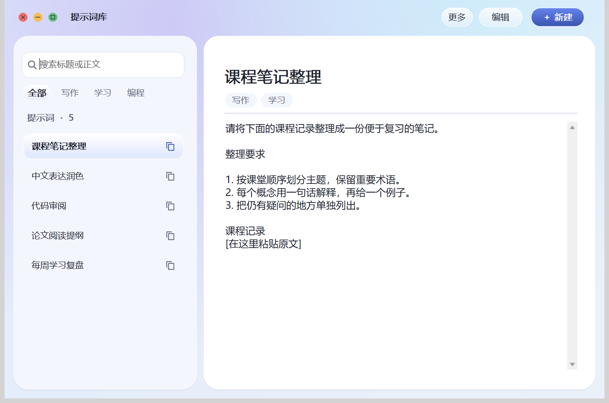
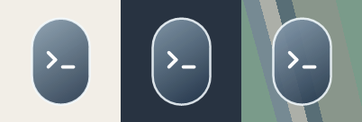

# 提示词

一个常驻 Windows 11 桌面的小型提示词库。点击屏幕边缘的玻璃胶囊打开管理窗口，在左侧选分类、搜索标题或正文，点击行旁的「复制」即可取用。提示词保存在本机。





## 使用

1. 从仓库的 [Releases](https://github.com/zhongfangxun-ops/prompt-manager/releases) 下载 Windows x64 压缩包，解压到固定位置，运行 `PromptManager.exe`。
2. 点击贴边胶囊打开窗口。「新建」可填写标题、正文和标签，输入新标签后按 Enter，或用「选择标签」勾选与取消已有项。
3. 点标签后输入关键词，可在该分类内搜索正文。「全部」恢复全库。点击行标题阅读，点击「复制」复制正文；复制成功后该条会移到最近使用的位置。
4. 浏览时按 Esc 或关闭窗口会收回桌面入口。胶囊可以拖到任一屏幕边缘。ChatGPT 桌面应用和 Google Chrome 全屏时仍会显示胶囊，其他应用全屏时会自动隐藏。右键系统托盘图标可收起胶囊、设置登录启动或退出进程。

| 快捷键 | 操作 |
|---|---|
| Ctrl+N / Ctrl+F | 新建 / 搜索 |
| Ctrl+S | 保存正在编辑的提示词 |
| Enter 或 Ctrl+C | 焦点在条目列表时复制所选正文 |
| Esc | 收起浏览窗口，或返回编辑前的状态 |

资料库位于 `%LOCALAPPDATA%\PromptManager\library.sqlite3`。备份时可从托盘退出应用后复制该文件。移动便携程序后，如使用登录启动，请重新关开一次该选项。默认关闭登录启动。

## 开发

在 Windows x64 的 MSYS2 UCRT64 环境中安装 GCC、CMake、Ninja 和 SQLite 开发文件。从项目根目录运行以下命令。

```powershell
cmake -S . -B build -G Ninja -DCMAKE_BUILD_TYPE=Release
cmake --build build
ctest --test-dir build --output-on-failure
cmake --install build --prefix dist/PromptManager
```

GitHub Actions 会在 Windows 上运行原生测试与发布程序的交互回归。界面测试使用临时数据库。剪贴板集成测试适合独立测试机，涉及真实 Windows 剪贴板。性能脚本需要 Python 和 psutil，界面验证和截图库另需 pywin32、Pillow。

[首版实施方案](docs/superpowers/plans/2026-11-21-prompt-manager-v1.md) · [性能与验收记录](docs/verification-v1.md)
